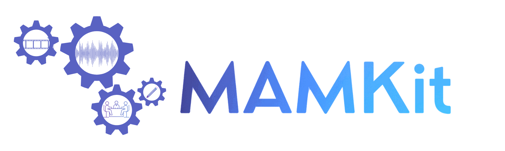

<div align="center">



# MAMKit

[](https://github.com/nlp-unibo/mamkit/actions/workflows/ci.yml)
[](https://nlp-unibo.github.io/mamkit/)
[](https://pypi.org/project/mamkit/)

</div>

A comprehensive toolkit for multimodal argument mining.

Multimodal argument mining (MAM) studies arguments in speech.
A model reads the transcript of a sentence, its audio, or both, and classifies the sentence or the relation between two sentences.

The corpora that MAMKit ships are political debates with aligned transcripts and recordings.
MAMKit runs the models of the MAMKit paper on four corpora under one configuration system, one training loop, and one set of metrics.
Every experiment of the paper is a registered task.
Reproducing a result is therefore running one key, and comparing two models is a change of key.

MAMKit is built on [Cinnamon](https://nlp.unibo.it/cinnamon/).
Corpora, split strategies, featurizers, models, and metrics are components with registered configurations.
A task names each of them by key.

[Documentation](https://nlp-unibo.github.io/mamkit/) ·
[Tutorial](https://nlp-unibo.github.io/mamkit/tutorials/quickstart.html) ·
[Contributing](CONTRIBUTING.md)

## Installation

MAMKit requires Python 3.10 or later.

```bash
pip install mamkit
```

Audio tasks also need [FFmpeg](https://www.ffmpeg.org/) on the system path, for example through `sudo apt install ffmpeg` or `brew install ffmpeg`.

The `cmn-run` command, which runs registered tasks interactively, needs the `cli` extra of Cinnamon:

```bash
pip install "cinnamon-core[cli]"
```

## Quickstart

A task is one experiment from start to finish: a corpus, a split strategy, a featurizer per modality, a model, its metrics, and a list of seeds.
The script below runs the toy task, which trains a text BiLSTM on a synthetic corpus in seconds on a CPU.

```python
from pathlib import Path

import mamkit
from cinnamon.registry import Registry
from mamkit.configurations.keys import TOY_TASK

Registry.build(directory=Path(mamkit.__file__).parent)

task = Registry.from_key(TOY_TASK, save_path="results", seeds=[0, 1])
results = task.run()
print(results["test"]["f1"])
```

```
{'per_seed_mean': [1.0, 1.0], 'per_seed_std': [0.0, 0.0], 'mean': 1.0, 'std': 0.0}
```

For each seed and split, the task builds fresh featurizers and a fresh model, trains with early stopping on the validation loss, and scores the best checkpoint.
`per_seed_mean` and `per_seed_std` summarize the splits of each seed, and `mean` and `std` summarize the per-seed means.
The same results land in `results/results.json`, beside the checkpoints.
The toy corpus marks each label with a cue word, so a perfect score only shows that the run holds together.

An experiment of the paper is a key with the name `task` in the `mamkit` namespace.
Its tags name the corpus, the task, the input mode, the model family, and the source of the configuration:

```python
from cinnamon.registry import RegistrationKey

key = RegistrationKey(
    name="task",
    tags={"ukdebates", "asd", "text-only", "bilstm", "mancini-et-al-2022"},
    namespace="mamkit",
)
results = Registry.from_key(key).run()
```

On first use, the task downloads UKDebates and the GloVe vectors into the working directory.
It writes its results under `results/ukdebates/asd/text-only/bilstm/mancini-et-al-2022`.
`cmn-run -dir mamkit`, from a clone of the repository, offers every registered task from the command line.

## Tasks

| Tag | Task | Corpora |
|---|---|---|
| `asd` | Argumentative sentence detection | UKDebates, MM-USED |
| `acc` | Argumentative component classification, claim or premise | MM-USED |
| `arc` | Argumentative relation classification, support, attack, or neither | M-Arg |
| `afc` | Argumentative fallacy classification, over six fallacy categories | MM-USED-fallacy |
| `afd` | Argumentative fallacy detection | MM-USED-fallacy |

Each task runs in one of three input modes, `text-only`, `audio-only`, or `text-audio`, and the mode is a tag of its key.

## Models

| Model | Text encoding | Audio encoding | Fusion | Tags |
|---|---|---|---|---|
| **BiLSTM** | GloVe and BiLSTM | MFCCs, or a pretrained audio model, and BiLSTM | Concatenation | `bilstm`, `bilstm-mfcc`, `bilstm-transformer` |
| **Transformer** | BERT or RoBERTa | Pretrained audio model and BiLSTM | Concatenation | `transformer`, `mmtransformer` |
| **Audio Transformer** | None | Pretrained audio model and Transformer encoder | None | `transformer-encoder` |
| **CSA** | BERT token embeddings | Pretrained audio model | Self-attention over the concatenated sequences | `csa` |
| **Ensemble** | BERT token embeddings | Pretrained audio model and Transformer encoder | Learned average of the two class distributions | `ensemble` |
| **MulTA** | BERT token embeddings | Pretrained audio model | Cross-modal attention in both directions | `multa` |

The pretrained audio model is wav2vec 2.0 by default.
The HuBERT and WavLM variants of a task carry a tag such as `audio.model_card=facebook/hubert-base-ls960`.
The [models page](https://nlp-unibo.github.io/mamkit/models/index.html) describes each family.

## Corpora

| Corpus | Source | Tasks | Size | Splits |
|---|---|---|---|---|
| **UKDebates** | [Lippi and Torroni, 2016](https://doi.org/10.1145/2850417) | ASD | 386 sentences from the 2015 UK Prime Ministerial debate | Folds of Mancini et al. (2022) |
| **M-Arg** | [Mestre et al., ArgMining 2021](https://doi.org/10.18653/v1/2021.argmining-1.8) | ARC | 4,104 sentence pairs from the 2020 US presidential debates, of which 2,443 have an agreement confidence of at least 85% | Folds of Mancini et al. (2022), on the 85% subset |
| **MM-USED** | [Mancini et al., ArgMining 2022](https://aclanthology.org/2022.argmining-1.15) | ASD, ACC | 23,505 sentences from 39 US presidential debates aired from 1960 to 2016 | Fixed training, validation, and test sets |
| **MM-USED-fallacy** | [Mancini et al., EACL 2024](https://aclanthology.org/2024.eacl-short.16) | AFC, AFD | 1,278 fallacious snippets from the same debates | Leave one dialogue out, from Mancini et al. (2024) |

The alignment of MM-USED and MM-USED-fallacy was refined after their publication, so their sample counts differ from the original papers.
Each corpus is downloaded on first use.
MM-USED and MM-USED-fallacy download the debate recordings only for a task that reads audio.

## Metrics

| Corpus | Score |
|---|---|
| **UKDebates** | F1 of the claim class |
| **M-Arg** | F1 of the support and attack classes, averaged |
| **MM-USED** | Macro F1 |
| **MM-USED-fallacy** | Macro F1 |

The [leaderboard](https://nlp-unibo.github.io/mamkit/reference/leaderboard.html) reports the results of the MAMKit paper.

## Contact

Questions about a component or a result are best raised as an [issue](https://github.com/nlp-unibo/mamkit/issues).
For anything else, write to [Eleonora Mancini](mailto:e.mancini@unibo.it) or [Federico Ruggeri](mailto:federico.ruggeri6@unibo.it).

## Citation

If you use MAMKit in your research, please cite the following paper:

```bibtex
@inproceedings{mancini-etal-2024-mamkit,
    title = "{MAMK}it: A Comprehensive Multimodal Argument Mining Toolkit",
    author = "Mancini, Eleonora  and
      Ruggeri, Federico  and
      Colamonaco, Stefano  and
      Zecca, Andrea  and
      Marro, Samuele  and
      Torroni, Paolo",
    editor = "Ajjour, Yamen  and
      Bar-Haim, Roy  and
      El Baff, Roxanne  and
      Liu, Zhexiong  and
      Skitalinskaya, Gabriella",
    booktitle = "Proceedings of the 11th Workshop on Argument Mining (ArgMining 2024)",
    month = aug,
    year = "2024",
    address = "Bangkok, Thailand",
    publisher = "Association for Computational Linguistics",
    url = "https://aclanthology.org/2024.argmining-1.7",
    doi = "10.18653/v1/2024.argmining-1.7",
    pages = "69--82",
}
```

## Acknowledgement

This work was partially supported by project FAIR: Future Artificial Intelligence Research (European Commission NextGeneration EU programme, PNRR-M4C2-Investimento 1.3, PE00000013-"FAIR" - Spoke 8).
